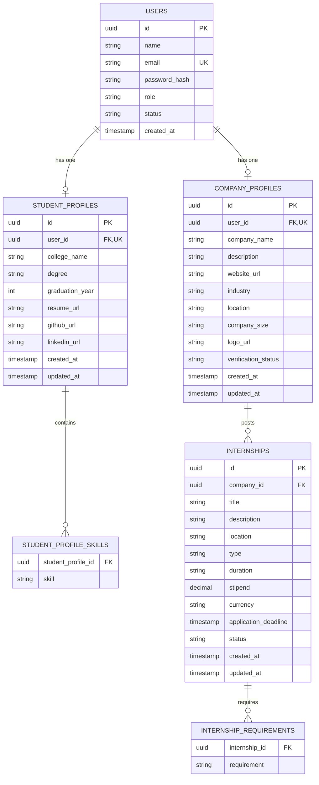

# InternHub — Backend API

[](https://www.oracle.com/java/technologies/javase/jdk17-archive-downloads.html)
[](https://spring.io/projects/spring-boot)
[](https://spring.io/projects/spring-security)
[](https://www.postgresql.org/)
[](https://github.com/jwtk/jjwt)
[]()
[](LICENSE)

**InternHub** is a modern, secure, and production-ready RESTful backend platform engineered to connect students seeking internship opportunities with companies looking to discover top talent. Built with **Spring Boot 4**, **Spring Security 7**, and **PostgreSQL**, it provides enterprise-grade authentication, role-based authorization, and modular profile and listing management.

---

## Table of Contents

- [Features](#features)
- [Architecture & Tech Stack](#architecture--tech-stack)
- [Entity-Relationship Diagram](#entity-relationship-diagram)
- [API Endpoints Reference](#api-endpoints-reference)
  - [Authentication](#1-authentication-api-public)
  - [Current User](#2-user-profile-api)
  - [Student Profiles](#3-student-profile-api)
  - [Company Profiles](#4-company-profile-api)
  - [Internship Listings](#5-internship-listings-api)
- [Getting Started](#getting-started)
  - [Prerequisites](#prerequisites)
  - [Database Setup](#database-setup)
  - [Environment Variables](#environment-variables)
  - [Running the Application](#running-the-application)
- [Running Automated Tests](#running-automated-tests)
- [Project Structure](#project-structure)
- [Error Handling](#error-handling)
- [Roadmap](#roadmap)

---

## Features

### 1. Robust Authentication & Security
- **Stateless JWT Authorization**: Bearer tokens issued via **JJWT 0.12.6** (HMAC-SHA256, 15-minute expiration).
- **Strong Password Hashing**: Passwords stored as BCrypt hashes (`$2a$`); raw passwords are never saved or exposed.
- **Role-Based Access Control (RBAC)**: Fine-grained method security (`@PreAuthorize`) enforcing `STUDENT`, `COMPANY`, and `ADMIN` role boundaries.
- **Account State Verification**: Suspended or inactive accounts are immediately blocked from authentication.
- **CSRF-Protected Design**: Stateless bearer tokens eliminate CSRF vulnerability vectors.

### 2. User & Student Profile Management
- Database-backed `GET /api/users/me` endpoint resolving the current user context directly from the security context.
- Dedicated `StudentProfile` entity storing university, degree, graduation year, skills list (`@ElementCollection`), resume URL, and social profiles (GitHub, LinkedIn).
- Idempotent upsert (`PUT /api/students/me`) returning `201 Created` on creation and `200 OK` on updates without database duplication.

### 3. Company Profile Management
- Dedicated `CompanyProfile` entity storing company name, industry, description, website URL, location, company size, logo URL, and `verificationStatus` (default `PENDING`).
- Company-restricted management endpoints (`GET /api/companies/me`, `PUT /api/companies/me`).
- Public view endpoint (`GET /api/companies/{id}`) allowing students to explore hiring organizations.

### 4. Internship Listings Management
- Full lifecycle management for internship postings by verified companies (`POST`, `PUT`, `DELETE`).
- Ownership verification: Companies can only edit or delete their own postings.
- Filter and search: Multi-field search across title, description, company name, location, internship type (`REMOTE`, `ONSITE`, `HYBRID`), and status (`OPEN`, `CLOSED`, `DRAFT`).
- Eager fetch optimization (`JOIN FETCH`) eliminating JPA $N+1$ query issues.

---

## Architecture & Tech Stack

- **Java**: 17 (compiled with `--release 17`)
- **Framework**: Spring Boot 4.1.1
- **Security**: Spring Security 7 (Stateless filter chain, `DaoAuthenticationProvider`)
- **Persistence**: Spring Data JPA / Hibernate (Jakarta Persistence 3.x)
- **Database**: PostgreSQL
- **JWT**: JJWT 0.12.6 (`jjwt-api`, `jjwt-impl`, `jjwt-jackson`)
- **Validation**: Jakarta Bean Validation (Hibernate Validator 9)
- **Build Tool**: Apache Maven (`./mvnw` included)
- **Testing**: JUnit 5, Mockito, Spring MVC Test (MockMvc standalone setup)

---

## Entity-Relationship Diagram



---

## API Endpoints Reference

### Base URL: `http://localhost:8080`

### 1. Authentication API (Public)

| Method | Endpoint | Access | Description | Status Code |
| :--- | :--- | :---: | :--- | :---: |
| `POST` | `/api/auth/register` | Public | Register new user account (defaults to `STUDENT`) | `201 Created` |
| `POST` | `/api/auth/login` | Public | Authenticate user and receive JWT access token | `200 OK` |

#### Registration Request Example
```json
POST /api/auth/register
Content-Type: application/json

{
  "name": "Jane Student",
  "email": "jane@example.com",
  "password": "Password@123"
}
```

#### Auth Response Example
```json
{
  "accessToken": "eyJhbGciOiJIUzI1NiJ9...",
  "tokenType": "Bearer",
  "expiresIn": 900,
  "userId": "d290f1ee-6c54-4b01-90e6-d701748f0851",
  "name": "Jane Student",
  "email": "jane@example.com",
  "role": "STUDENT"
}
```

---

### 2. User Profile API

| Method | Endpoint | Access | Description | Status Code |
| :--- | :--- | :---: | :--- | :---: |
| `GET` | `/api/users/me` | Authenticated | Retrieve current user profile (excludes password hash) | `200 OK` |

---

### 3. Student Profile API

| Method | Endpoint | Access | Description | Status Code |
| :--- | :--- | :---: | :--- | :---: |
| `GET` | `/api/students/me` | `ROLE_STUDENT` | Retrieve authenticated student's profile (404 if missing) | `200 OK` / `404` |
| `PUT` | `/api/students/me` | `ROLE_STUDENT` | Upsert student profile | `201 Created` / `200 OK` |

#### Upsert Student Profile Request Example
```json
PUT /api/students/me
Authorization: Bearer <TOKEN>
Content-Type: application/json

{
  "collegeName": "Stanford University",
  "degree": "B.S. in Computer Science",
  "graduationYear": 2026,
  "skills": ["Java", "Spring Boot", "PostgreSQL", "Docker"],
  "resumeUrl": "https://storage.example.com/resumes/jane_resume.pdf",
  "githubUrl": "https://github.com/janestudent",
  "linkedinUrl": "https://linkedin.com/in/janestudent"
}
```

---

### 4. Company Profile API

| Method | Endpoint | Access | Description | Status Code |
| :--- | :--- | :---: | :--- | :---: |
| `GET` | `/api/companies/me` | `ROLE_COMPANY` | Retrieve authenticated company profile (404 if missing) | `200 OK` / `404` |
| `PUT` | `/api/companies/me` | `ROLE_COMPANY` | Upsert company profile (status starts at `PENDING`) | `201 Created` / `200 OK` |
| `GET` | `/api/companies/{id}` | Authenticated | Public view of company details by UUID | `200 OK` / `404` |

#### Upsert Company Profile Request Example
```json
PUT /api/companies/me
Authorization: Bearer <TOKEN>
Content-Type: application/json

{
  "companyName": "Acme Innovations Inc",
  "description": "Leading cloud infrastructure and distributed systems provider.",
  "websiteUrl": "https://acme.example.com",
  "industry": "Cloud Computing",
  "location": "San Francisco, CA",
  "companySize": "200-500",
  "logoUrl": "https://acme.example.com/logo.png"
}
```

---

### 5. Internship Listings API

| Method | Endpoint | Access | Description | Status Code |
| :--- | :--- | :---: | :--- | :---: |
| `POST` | `/api/internships` | `ROLE_COMPANY` | Create a new internship listing | `201 Created` |
| `GET` | `/api/internships/my` | `ROLE_COMPANY` | Get all postings created by authenticated company | `200 OK` |
| `PUT` | `/api/internships/{id}` | `ROLE_COMPANY` | Update an internship listing (ownership verified) | `200 OK` |
| `DELETE` | `/api/internships/{id}` | `ROLE_COMPANY` | Delete an internship listing (ownership verified) | `204 No Content` |
| `GET` | `/api/internships/{id}` | Authenticated | View detailed internship listing by UUID | `200 OK` / `404` |
| `GET` | `/api/internships` | Authenticated | Search & filter active internships | `200 OK` |

#### Create Internship Request Example
```json
POST /api/internships
Authorization: Bearer <COMPANY_TOKEN>
Content-Type: application/json

{
  "title": "Backend Engineering Intern",
  "description": "Develop high-throughput Spring Boot microservices.",
  "requirements": ["Java", "Spring Boot", "PostgreSQL", "Kafka"],
  "location": "San Francisco, CA",
  "type": "HYBRID",
  "duration": "12 weeks",
  "stipend": 6500.00,
  "currency": "USD",
  "status": "OPEN"
}
```

#### Query Parameters for Internship Search (`GET /api/internships`)
- `keyword`: Searches across title, description, and company name (e.g. `?keyword=Backend`)
- `type`: `REMOTE`, `ONSITE`, or `HYBRID` (e.g. `?type=REMOTE`)
- `location`: Partial case-insensitive location match (e.g. `?location=San Francisco`)
- `status`: Filter by status (`OPEN`, `CLOSED`, `DRAFT`; defaults to `OPEN`)

---

## Getting Started

### Prerequisites
- **JDK 17** or higher
- **PostgreSQL 14+** running locally or in Docker
- **Maven 3.8+** (or use the included `./mvnw`)

---

### Database Setup
Log into PostgreSQL via `psql` or pgAdmin and create the database:

```sql
CREATE DATABASE internhub;
```

Hibernate schema-management (`spring.jpa.hibernate.ddl-auto=update`) automatically generates and updates the required tables on application startup.

---

### Environment Variables
Configure the following environment variables in your terminal or IDE Run Configuration:

| Variable | Description | Default |
| :--- | :--- | :---: |
| `DB_PASSWORD` | PostgreSQL user password | *(Required)* |
| `JWT_SECRET` | 256-bit Base64-encoded secret key | *(Required)* |
| `DB_URL` | JDBC Connection URL | `jdbc:postgresql://localhost:5432/internhub` |
| `DB_USERNAME` | PostgreSQL username | `postgres` |

#### Generating a Secure Base64 JWT Secret Key
Generate a 256-bit (32-byte) key using OpenSSL:
```bash
openssl rand -base64 32
```
*Example output:*
```text
hGHMYSORcQZD5u9YIhnI7vCDeO0F85gZDY74wask6w4=
```

---

### Running the Application

#### Option 1: Via Maven Wrapper
```bash
export DB_PASSWORD=your_postgres_password
export JWT_SECRET=your_base64_jwt_secret

./mvnw spring-boot:run
```

#### Option 2: Run Packaged JAR
```bash
./mvnw clean package -DskipTests
java -jar target/InternHub-0.0.1-SNAPSHOT.jar
```

#### Option 3: IntelliJ IDEA
1. Open the project in IntelliJ IDEA.
2. Navigate to **Run** $\rightarrow$ **Edit Configurations...**
3. Select **InternHubApplication** (Spring Boot).
4. Add environment variables:
   ```text
   DB_PASSWORD=your_password;JWT_SECRET=your_base64_secret
   ```
5. Click **Run** or **Debug**.

---

## Running Automated Tests

InternHub comes with a comprehensive automated test suite covering unit tests, MockMvc controller slice tests, and Spring Security authorization handlers:

```bash
./mvnw clean test
```

### Test Coverage Highlights
- ✅ **Auth & JWT (`AuthServiceTest`, `JwtServiceTest`)**: Registration, BCrypt password hashing, credential validation, JWT token issuance, claim parsing, expiration, tampering rejection.
- ✅ **User Profiles (`UserServiceTest`, `UserControllerTest`)**: Identity extraction, password concealment.
- ✅ **Student Profiles (`StudentProfileServiceTest`, `StudentProfileControllerTest`)**: Upsert semantics (create vs update), role-based access control, input validation.
- ✅ **Company Profiles (`CompanyProfileServiceTest`, `CompanyProfileControllerTest`)**: Role enforcement, pending status assignment, public profile discovery.
- ✅ **Internship Postings (`InternshipServiceTest`, `InternshipControllerTest`)**: Creation, cross-company ownership protection on edit/delete, multi-criteria search queries.
- ✅ **Security Handlers (`CustomSecurityHandlersTest`)**: Standardized 401 Unauthorized and 403 Forbidden responses.

---

## Project Structure

```text
src/
├── main/
│   ├── java/
│   │   └── com/
│   │       └── mkj/
│   │           └── InternHub/
│   │               ├── auth/                  # Authentication & JWT services/filters
│   │               │   ├── dto/               # Auth request & response DTOs
│   │               │   ├── AuthService.java
│   │               │   ├── JwtAuthenticationFilter.java
│   │               │   └── JwtService.java
│   │               ├── controller/            # REST API endpoints
│   │               │   ├── AuthController.java
│   │               │   ├── CompanyProfileController.java
│   │               │   ├── InternshipController.java
│   │               │   ├── StudentProfileController.java
│   │               │   └── UserController.java
│   │               ├── dto/                   # Profile & listing DTOs
│   │               ├── entity/                # JPA entities & domain enums
│   │               │   ├── CompanyProfile.java
│   │               │   ├── Internship.java
│   │               │   ├── InternshipStatus.java
│   │               │   ├── InternshipType.java
│   │               │   ├── Role.java
│   │               │   ├── StudentProfile.java
│   │               │   └── UserEntity.java
│   │               ├── exception/             # Centralized exception handling
│   │               │   ├── AccountNotActiveException.java
│   │               │   ├── EmailAlreadyExistsException.java
│   │               │   ├── ErrorResponse.java
│   │               │   ├── GlobalExceptionHandler.java
│   │               │   └── ResourceNotFoundException.java
│   │               ├── repository/            # Spring Data JPA repositories
│   │               ├── security/              # Spring Security configuration & handlers
│   │               │   ├── CustomAccessDeniedHandler.java
│   │               │   ├── CustomAuthenticationEntryPoint.java
│   │               │   └── SecurityConfig.java
│   │               └── InternHubApplication.java
│   └── resources/
│       └── application.properties             # Environment-backed configuration
└── test/
    └── java/com/mkj/InternHub/                # Comprehensive test suites
```

---

## Error Handling

InternHub uses a centralized [`GlobalExceptionHandler`](file:///home/mkj77/Desktop/College/sedp/InternHub/src/main/java/com/mkj/InternHub/exception/GlobalExceptionHandler.java) to catch application and security exceptions, ensuring sensitive internal details (stack traces, SQL errors, database credentials) are never leaked.

### Unified JSON Error Format
```json
{
  "timestamp": "2026-10-26T10:00:00Z",
  "status": 400,
  "error": "Bad Request",
  "message": "Validation failed",
  "details": {
    "title": "Title is required",
    "location": "Location is required"
  }
}
```

| HTTP Status | Triggering Scenario |
| :---: | :--- |
| `400 Bad Request` | Jakarta Bean Validation violations (`@Valid`) |
| `401 Unauthorized` | Invalid email/password, unauthenticated requests, expired/malformed JWT |
| `403 Forbidden` | Access denied due to role mismatch (`@PreAuthorize`) or resource ownership check |
| `404 Not Found` | Requested user, profile, or internship not found (`ResourceNotFoundException`) |
| `409 Conflict` | Duplicate email during registration (`EmailAlreadyExistsException`) |
| `500 Internal Server Error` | Unexpected system exceptions (returns sanitized generic message) |

---

## Roadmap

- [x] **Phase 1**: Authentication & Security (JWT, BCrypt, Spring Security 7).
- [x] **Phase 2**: User & Student Profile Management (`/api/users/me`, `/api/students/me`).
- [x] **Phase 3**: Company Profile Management (`/api/companies/me`, `/api/companies/{id}`).
- [x] **Phase 4**: Internship Listings Management (CRUD, ownership checks, multi-parameter search).
- [ ] **Phase 5**: Internship Application Workflow (Student apply, duplicate prevention, status pipeline: `APPLIED`, `REVIEWED`, `SHORTLISTED`, `ACCEPTED`, `REJECTED`).
- [ ] **Phase 6**: File upload service for resumes and company logos (AWS S3 / MinIO integration).
- [ ] **Phase 7**: Email notifications (Application updates, interview invites).

---

## License

This project is licensed under the [MIT License](LICENSE).
